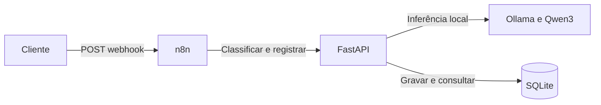

# KODIE | Classificação e roteamento de mensagens

Uma API recebe mensagens de atendimento, classifica a intenção, sugere prioridade e setor, e entrega um resultado estruturado ao n8n. O workflow aplica as regras de encaminhamento, registra a mensagem em uma fila persistente e devolve um comprovante de gravação.

## 1. Apresentação da ideia

Uma pequena empresa recebe dúvidas, solicitações e reclamações no mesmo canal. A triagem manual atrasa o encaminhamento e dificulta a identificação de ocorrências prioritárias. O projeto organiza essa entrada e permite localizar cada mensagem pelo identificador do comprovante.

## 2. Problema escolhido

**Caso 4.1 — Classificação de mensagens.** O objetivo é transformar uma mensagem livre em uma decisão verificável. Um pedido de segunda via deve chegar à fila financeira. Uma falha que interrompe vendas deve ir para atendimento prioritário. Quando a classificação falha, a mensagem original segue para triagem.

## 3. Solução proposta



A FastAPI valida a entrada e pede ao Ollama uma saída conforme JSON Schema. O Pydantic valida o retorno antes de aceitá-lo. O n8n decide a fila, solicita a gravação à API e devolve o recibo ao cliente. O Ollama roda dentro da rede do Compose, na mesma máquina, e o modo local dispensa chave de API externa.

## 4. Tecnologias utilizadas

| Camada | Stack |
| --- | --- |
| Serviço HTTP | Python 3.12, FastAPI, Uvicorn, Pydantic e HTTPX |
| Inferência local | Ollama 0.40.18 e Qwen3 1.7B (`qwen3:1.7b`), em CPU |
| Automação | n8n 2.49.6, com workflow versionado em JSON |
| Persistência | SQLite em modo WAL, com chave única por encaminhamento |
| Infraestrutura e testes | Docker Compose, `unittest` e teste de integração HTTP |

## 5. Funcionamento do sistema

| Endpoint | Comportamento |
| --- | --- |
| `GET /health` | Indica que a API iniciou e informa o modo `demo` ou `ollama`. |
| `POST /classificacoes` | Recebe `{"mensagem":"..."}` e retorna `200` com ID, origem e classificação. |
| `POST /encaminhamentos` | Registra a mensagem e sua fila. Retorna `201` para uma nova gravação, `200` se o mesmo ID e conteúdo já estiverem registrados, ou `409` se o ID for reutilizado com outro conteúdo. |
| `GET /encaminhamentos?fila=financeiro&limite=20` | Lista os registros mais recentes da fila. O limite aceito é de 1 a 100. |
| `POST /webhook/classificar-mensagem` | Executa classificação, roteamento e gravação. Retorna `201` após persistir, `422` para entrada inválida ou `502` quando a integração com a API falha. |

A mensagem deve ter de 1 a 3.000 caracteres após a remoção de espaços nas extremidades. O contrato rejeita propriedades extras. A classificação contém `categoria`, `prioridade`, `resumo` e `setor_sugerido`. A origem distingue inferência (`ollama`), regras locais de demonstração (`demonstracao`) e triagem por indisponibilidade ou saída inválida (`fallback`).

### Ordem de roteamento

| Primeira condição atendida | Destino |
| --- | --- |
| Origem `fallback` | `triagem` |
| Prioridade `alta` | `prioritario` |
| Categoria `outro` | `triagem` |
| Demais classificações | Setor sugerido: `atendimento`, `comercial`, `financeiro`, `operacoes` ou `suporte` |

A proteção contra duplicidade vale para a gravação com o mesmo ID. Cada nova chamada ao webhook gera seu próprio ID. No Compose, a API e o editor do n8n escutam somente no loopback do host. O Ollama não publica porta no host. Use mensagens fictícias para demonstração, pois a fila e o histórico do n8n armazenam o texto original.

### Evidências e resultados na VPS

Validação de 25/11/2026 em Docker Compose, com o workflow publicado e a API em modo `ollama`.

| Caso | Categoria | Fila | Resultado |
| --- | --- | --- | --- |
| Preço de um plano | `duvida` | `comercial` | `201`, `origem: ollama`, registro consultado |
| Segunda via de boleto | `solicitacao` | `financeiro` | `201`, `origem: ollama`, registro consultado |
| Sistema fora do ar com vendas interrompidas | `reclamacao` | `prioritario` | `201`, `origem: ollama`, registro consultado |
| Pedido fora do prazo | `reclamacao` | `operacoes` | `201`, `origem: ollama`, registro consultado |
| Saudação sem solicitação | `outro` | `triagem` | `201`, `origem: ollama`, registro consultado |
| Mensagem em branco | — | — | `422` |

A bateria levou **71,27 s**. O `docker compose stats` mediu **aproximadamente 3 GiB de RAM somados** logo após o teste: Ollama **2,607 GiB**, n8n **401,8 MiB** e API **38,27 MiB**. Esses valores descrevem a execução observada na VPS.

A [evidência da execução nº 10](docs/prints/execucao-10.json) reúne o pedido de segunda via, a classificação `solicitacao`, a prioridade `media`, a fila `financeiro` e o mesmo ID na gravação e na consulta. O [índice de capturas](docs/prints/README.md) organiza o canvas, a execução bem-sucedida, as configurações dos seis nós e as saídas por etapa.

## 6. Como executar

### Docker Compose

Requisitos: Docker Engine, Compose e acesso para baixar as imagens e o modelo. Execute na raiz do repositório. No PowerShell, use `Copy-Item .env.example .env` para copiar a configuração.

```bash
cp .env.example .env
docker compose --profile inferencia up -d --wait ollama
docker compose --profile inferencia exec -T ollama ollama pull qwen3:1.7b
```

No `.env`, defina `CLASSIFIER_MODE=ollama`. O modo padrão `demo` permite testar o fluxo sem carregar o modelo. O primeiro download do Qwen3 usa cerca de 1,4 GB de disco, além da imagem do Ollama.

```bash
docker compose --profile inferencia up -d --build --wait
docker compose --profile inferencia ps
```

1. Abra `http://localhost:5678` no host. Se estiver em uma VPS, use o túnel descrito no [guia operacional](docs/entrega.md#acesso-ao-n8n-na-vps).
2. Crie a conta local no primeiro acesso. Em um workflow vazio, escolha **Import from File** e selecione [`n8n/workflow-classificacao-mensagens.json`](n8n/workflow-classificacao-mensagens.json).
3. Salve e publique o workflow. O webhook publicado fica em `/webhook/classificar-mensagem`.

Em modo `demo`, basta `docker compose up -d --build --wait`. Para encerrar o ambiente, use `docker compose --profile inferencia down`. Esse comando preserva os volumes com o workflow, a fila e o modelo.

### API e testes de integração

```bash
curl -fsS http://127.0.0.1:8000/health

curl -i http://127.0.0.1:5678/webhook/classificar-mensagem \
  -H 'Content-Type: application/json' \
  --data '{"mensagem":"Podem emitir a segunda via do boleto?"}'

curl -fsS 'http://127.0.0.1:8000/encaminhamentos?fila=financeiro&limite=20'
python3 tests/smoke_n8n.py --modo ollama
```

O webhook deve devolver HTTP `201`, `origem: ollama` e `fila: financeiro`. Confirme o ID do comprovante na consulta à fila. Para testar com regras locais, execute `python3 tests/smoke_n8n.py` com a API em `demo`. O contrato HTTP pode ser consultado em `http://127.0.0.1:8000/docs`.

Para rodar os testes unitários com Python 3.12 em um ambiente virtual:

```bash
python3 -m venv .venv
.venv/bin/python -m pip install -r requirements.txt
.venv/bin/python -m unittest discover -s tests -v
```

No Windows, o executável equivalente é `.\.venv\Scripts\python.exe`. Consulte o [guia operacional](docs/entrega.md) para acesso à VPS, captura de evidências, sincronização e publicação.
